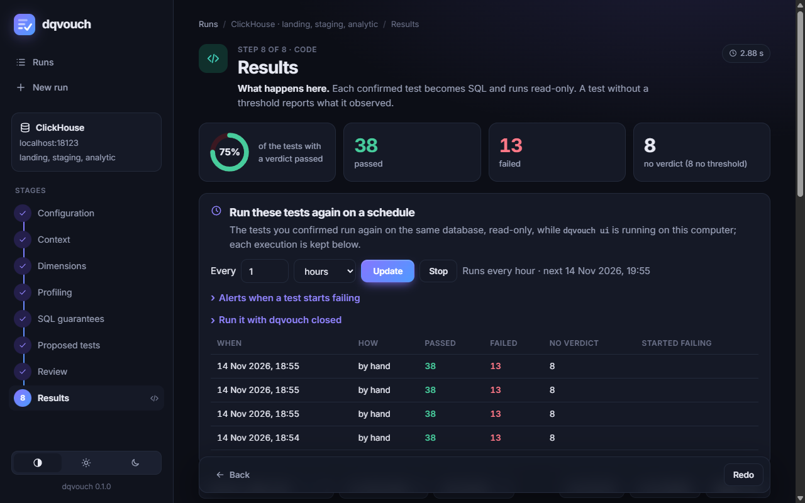
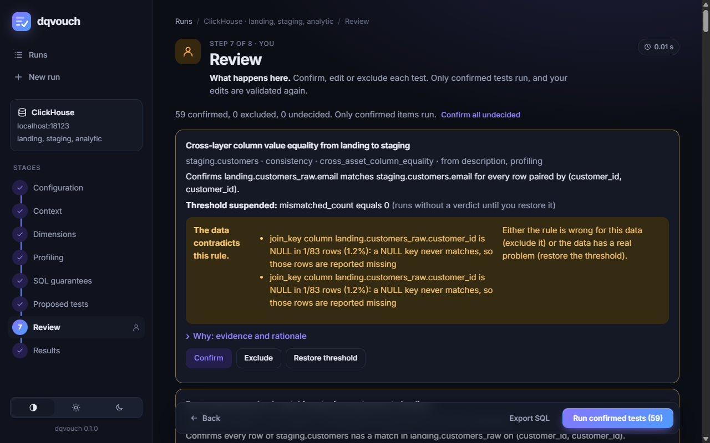
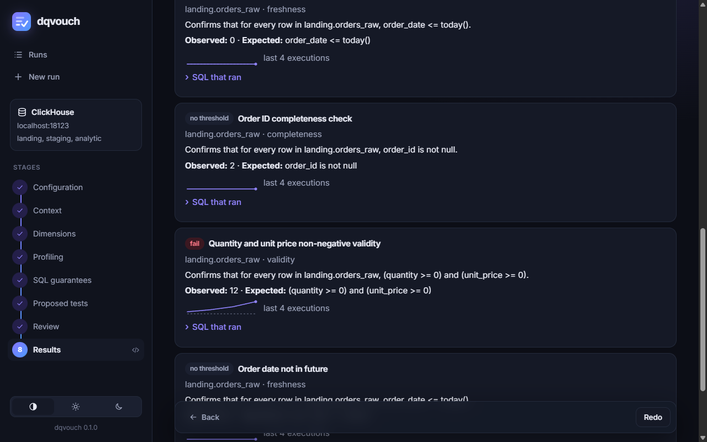
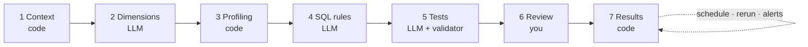
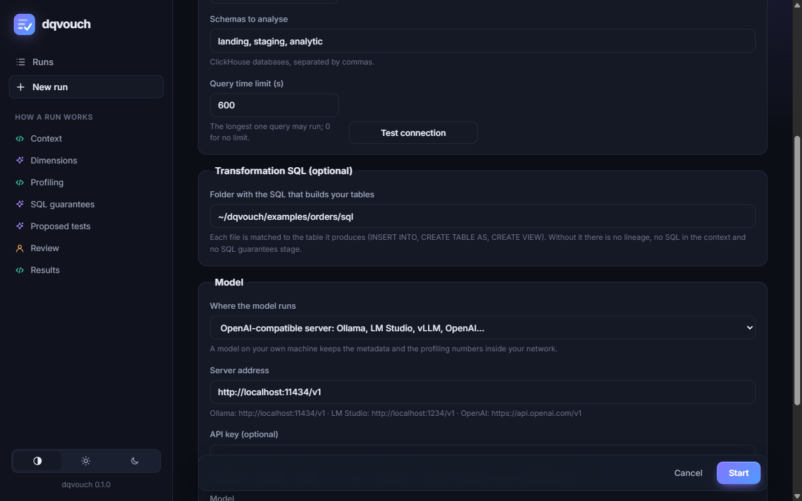

# dqvouch

[](https://github.com/FuzzyLaDuzzy/dqvouch/actions/workflows/ci.yml)
[](pyproject.toml)
[](LICENSE)

**An LLM proposes data quality tests, code validates them, you vouch for them.**

Works on **PostgreSQL** and **ClickHouse**, with Gemini or a model on your own machine, from a step-by-step web
interface or the command line.



Writing data quality tests by hand needs someone who knows the data, and it does not scale to hundreds of tables.
dqvouch reads what your pipeline already tells about each table (schema, descriptions, the SQL that builds it,
lineage), lets a language model propose tests, checks every proposal in code, and shows you the result before
anything runs. Then it keeps running the tests you confirmed and tells you when one starts failing.

**Contents:** [Features](#features) · [How it works](#how-it-works) · [Quickstart](#quickstart-fictional-orders-example)
· [Local model](#use-a-local-model) · [Run with dqvouch closed](#run-with-dqvouch-closed) ·
[Command line](#command-line) · [Configuration](#configuration) · [Results from the thesis](#results-from-the-thesis) ·
[Limitations](#limitations)

## Features

- **Tests from context, not from a blank page:** schema, column comments, the transformation SQL, lineage and
  measured profiles go to the model; what comes back is checked against the real schema and data.
- **The model never writes SQL.** It fills a closed catalog of five assertions; dqvouch renders the SQL, and every
  threshold has to cite evidence that resolves.
- **You decide.** Each test is confirmed, edited or excluded on the Review screen; rules the data contradicts are
  flagged, not dropped. A new run of the same database starts with your last decisions.
- **Read-only, enforced twice:** one `SELECT` at a time in the code, read-only sessions in the database, a time
  limit per query, and a warning when the user you gave it could write.
- **Gemini or a local model:** any OpenAI-compatible server (Ollama, LM Studio, vLLM) keeps your metadata inside
  your network.
- **Keeps watch:** in-app schedules, or `dqvouch rerun` from cron, Task Scheduler, Airflow or CI (exit code 1 when a
  test fails); every execution is kept, with each test's trend.
- **Alerts** by webhook (Slack, Teams, Google Chat, Mattermost) or email, once when a test starts failing, not at
  every run.
- **Take the tests anywhere:** export the confirmed tests as one SQL file in your database's dialect.

<table>
  <tr>
    <td width="50%"></td>
    <td width="50%"></td>
  </tr>
  <tr>
    <td><sub>Review: a rule the data contradicts is flagged; you confirm, exclude or restore it.</sub></td>
    <td><sub>Results: each test's observed value over the last executions, against its limit.</sub></td>
  </tr>
</table>

## How it works



| # | Stage | Who | What happens |
|---|---|---|---|
| 1 | Context | code | One `AssetContext` per table: columns, types, comments, the SQL that produces it, upstream and downstream tables, and facts the code extracts from the SQL (`dq_signals`). |
| 2 | Dimensions | LLM, 1 call | Which data quality dimensions (completeness, uniqueness, validity, consistency, freshness, accuracy) to check on which columns. The validator drops tables and columns that do not exist. |
| 3 | Profiling | code | Metric-only SQL for the accepted dimensions (null counts, duplicates, value frequencies...), run read-only. |
| 4 | SQL rules | LLM, 2 calls per transformation | What each transformation's SQL guarantees about its output and requires of its inputs, each tied to the SQL excerpt that enforces it. |
| 5 | Tests | LLM, 1 call per table and per table pair | Concrete tests from a closed catalog, checked by the validator (and optionally sent back once to be repaired). |
| 6 | Review | you | Confirm, edit or exclude each test. |
| 7 | Results | code | Each test rendered to SQL, run read-only, with a verdict: pass, fail, no threshold, not comparable or error. |

Three rules hold everywhere:

1. **The LLM proposes, the code validates, a person decides.**
2. **The LLM never writes SQL nor touches the database.** It returns structured JSON; SQL is generated by code from a
   closed catalog of five assertions (`row_predicate`, `unique`, `cross_asset_row_count`,
   `cross_asset_missing_rows`, `cross_asset_column_equality`).
3. **No threshold without evidence.** A limit is accepted only if it cites a fact that resolves (a column
   description, the SQL, a measured metric). Without one, the test only observes and reports the value. When the
   data contradicts a well-formed rule, the validator flags it for review instead of deleting it.

dqvouch only reads from your database: it sends one `SELECT` at a time and refuses anything else, PostgreSQL
sessions are opened read-only and ClickHouse queries carry `readonly = 2`, and every query stops after
`query_timeout_seconds` (600 by default). Still, connect with a read-only user: that is the guarantee that holds
whatever happens in between, and dqvouch warns you when the user it was given can write. On PostgreSQL grant it
`SELECT` only; on ClickHouse give it `readonly = 2` (`readonly = 1` also forbids writes, but then no time limit can
be sent with the queries).

Inside dqvouch all SQL and column types use one notation (ClickHouse's, the one the thesis evaluated); each database
connection translates at the boundary, so the same stages run unchanged on every engine, and the SQL saved with a
run is the SQL your database actually ran.

## Quickstart (fictional orders example)

Requires Python 3.11+, Docker and a [Gemini API key](https://aistudio.google.com/apikey).

```bash
git clone https://github.com/FuzzyLaDuzzy/dqvouch.git && cd dqvouch
sh install.sh                              # Windows: powershell -ExecutionPolicy Bypass -File install.ps1
docker compose up -d postgres              # PostgreSQL on localhost:15432
.venv/bin/python examples/orders/load.py   # 10 tables (orders, customers, returns), landing -> staging -> analytic, with planted defects
.venv/bin/dqvouch ui --config examples/orders/dqvouch.toml
```

On Windows the programs are in `.venv\Scripts\` instead of `.venv/bin/`. `install.sh` only creates `.venv` and runs
`pip install -e .` in it; do that yourself if you prefer.

The browser opens on the first screen with the example filled in. Paste your Gemini key, press **Start** and follow
the stages: each screen says what happens, whether code or the model does it, what was sent to Gemini and what came
back. Before the **Review** screen dqvouch only reads your tables' metadata and runs read-only measurement queries
(Context and Profiling); no test runs until you confirm it there and press **Run confirmed tests**. To use your own
database, press **New run** and fill in the first screen instead.

On the **Results** screen you can run the confirmed tests again on a schedule (every n minutes, hours or days).
The schedule runs while `dqvouch ui` is running on that computer; an execution missed while it was off runs once
when it starts again. To run them with dqvouch closed, the same screen gives you the line for cron or the Windows
Task Scheduler (see [Run with dqvouch closed](#run-with-dqvouch-closed)). Every execution is kept in the run's
`history.jsonl`: the screen lists them with the tests that started failing since the one before, and draws each
test's observed value over the last 20 executions, so a count creeping towards its limit shows before it fails.
Metric thresholds are measured again at every execution.

**Alerts:** on the same screen, a Slack, Mattermost, Google Chat or Teams webhook and/or an SMTP server get one
message when a test starts failing or erroring, or when an execution cannot run, and not again while it stays that
way. They apply to every run and are kept in `.env`; a failed send is noted in the history, never fails the run.

**Export SQL** (Review and Results) downloads the confirmed tests as one SQL file in your database's dialect, each
query with a comment saying what it checks and what it expects, to run them in your own tools without dqvouch.

A new run of the same database starts with the decisions of the last review made on the Review screen: tests that
check the same thing come confirmed or excluded as you left them (with your threshold), and you can show only the
new ones.

The interface only listens on `127.0.0.1` and refuses requests addressed to any other host name. The key and the
database password are saved in the `.env` file of the folder you start it from (a value already set in the
environment wins) and are never written to a run's files.

The same example on ClickHouse: `docker compose up -d clickhouse`, then
`python examples/orders/load.py examples/orders/dqvouch.clickhouse.toml` and
`dqvouch ui --config examples/orders/dqvouch.clickhouse.toml`.

## Use a local model

The model can run on your own machine, so the metadata and profiling numbers never leave your network. Any server
with OpenAI's chat completions API works: [Ollama](https://ollama.com), LM Studio, vLLM, llama.cpp, and also
hosted ones such as OpenAI or Azure. On the Configuration screen choose *OpenAI-compatible server*, or in the config:



```toml
[llm]
provider = "openai"
base_url = "http://localhost:11434/v1"   # Ollama; LM Studio: http://localhost:1234/v1
model = "qwen3:14b"
```

A key is only needed if the server asks for one (`OPENAI_API_KEY`). The Dimensions stage sends every table in one
prompt, and Ollama's default context is small and silently cuts longer prompts: start it with a larger one, e.g.
`OLLAMA_CONTEXT_LENGTH=32768 ollama serve`. The thesis numbers below were measured with Gemini; a local model may
propose different (and fewer valid) tests, which the validator still checks the same way.

## Run with dqvouch closed

```bash
dqvouch rerun runs/20261111-150012 --env-file .env
```

`rerun` executes a reviewed run's confirmed tests once, adds the execution to its history and sends the alerts. It
exits with 0 when no test failed or errored, 1 when one did and 2 when it could not run, so cron, the Windows Task
Scheduler, Airflow or a CI job can call it and act on the result. The Results screen shows the exact cron and
`schtasks` lines for your interval. Two executions of one run never overlap (a lock file in the run folder), so the
in-app schedule and an operating-system one can both be on.

`dqvouch export RUN_DIR [-o tests.sql]` writes the confirmed tests as one SQL file, like the Export SQL button.

## Command line

The command line runs every stage in one go, and is how the thesis experiments are reproduced:

```bash
echo GEMINI_API_KEY=your-key > .env
dqvouch run --config examples/orders/dqvouch.toml
```

The run stops before executing anything: edit `review_input.json` in the run folder (exclude a test, change a
threshold), save it and press Enter. The report lists every test with its verdict and observed value.

## Configuration

```toml
[database]
engine = "postgres"         # or "clickhouse"
host = "localhost"
port = 5432                 # ClickHouse: the HTTP port, usually 8123
database = "warehouse"      # PostgreSQL only: the database to connect to
user = "dq_reader"          # read-only is enough
password = ""               # better: set DQVOUCH_DB_PASSWORD
schemas = ["landing", "staging", "analytic"]   # PostgreSQL schemas or ClickHouse databases
query_timeout_seconds = 600 # the longest one query may run; 0 for no limit

[llm]
model = "gemini-3.5-flash-lite"   # the key comes from GEMINI_API_KEY (environment or .env)
# provider = "openai"             # a local or other model: see "Use a local model"
# base_url = "http://localhost:11434/v1"

[run]
sql_dir = "sql"    # optional: the transformation SQL; each file is matched to the table it produces
runs_dir = "runs"  # one folder per run
```

Transformation files are matched to tables by what they produce: `INSERT INTO t`, `CREATE TABLE t AS SELECT`,
or `CREATE [MATERIALIZED] VIEW t [TO t2]`. File names do not matter. Without SQL, dqvouch still works from the
schema and the comments, but finds fewer tests.

Command line options:

| Option | Meaning |
|---|---|
| `--tables SCHEMA.TABLE ...` | only these tables |
| `--level C1 C2 C3` | context level: C1 structure only, C2 + descriptions, C3 + SQL and lineage (default) |
| `--repeat N` | run every level N times (to measure the model's variance) |
| `--no-signals`, `--no-sql-rules`, `--no-repair` | turn a part off (ablations) |
| `--no-review` | execute the proposed tests without the review pause |

The web interface always runs the final configuration of the thesis (C3, with the SQL rules and the repair pass);
`dqvouch ui` takes `--config`, `--runs-dir`, `--port` (default 8765), `--env-file` and `--no-browser`.

## Developing the interface

The interface is Vue 3 + Vite in `frontend/`; its build lives in `src/dqvouch/static/` and is committed, so
installing dqvouch needs no Node.

```bash
python tests/serve_fake.py --slow 2        # the API on :8765 with a scripted model: no key, no quota
cd frontend && npm ci && npm run dev       # hot-reloading UI on :5173, proxied to :8765
npm test                                   # the UI's logic
npm run build                              # before every commit that changes the UI
```

## What a run leaves behind

Every run is a folder in `runs_dir`: `run.json` (the settings, without secrets) and one file per stage,
`01_context.json` to `07_results.json`, with the prompts, the raw model answers, what the validator accepted and
rejected and why, the profiling metrics and the verdicts. `history.jsonl` keeps every execution (verdicts, observed
values, alerts sent), `schedule.json` the in-app schedule, and `execution.lock` exists only while the tests run.
Nothing is written to your database.

## Results from the thesis

dqvouch comes from a master's dissertation that evaluated it on a real six-table pipeline against 18 tests written
by data engineers (`gemini-3.5-flash-lite`, temperature 0, 3 repetitions):

| | C1 | C2 | C3 | C3 + SQL rules |
|---|---|---|---|---|
| Engineers' tests found (18) | 33% | 22% | 39% | **67%** |
| ... on one table (11) | 55% | 36% | 64% | 82% |
| ... across tables (7) | 0% | 0% | 0% | **43%** |
| Tests per run | 88 | 87 | 70 | 117–142 |
| LLM calls | 13 | 13–15 | 15–17 | 47–49 |
| Duration | 4–5 min | 5–7 min | 5–6 min | 7 min |

Of the extra tests the framework proposed, the engineers judged 54% worth keeping, and 91% of those that came
from the SQL rules. Having the logic in the SQL is not enough: the model finds the rule when the question is the
right one, but choosing the key, telling a filter from a rule and knowing how data is loaded take operational
knowledge that is not in the code.

> Flávio Silva, *Framework para geração automática de verificações de qualidade de dados*, MSc dissertation,
> Universidade do Minho, 2026.

## Limitations

- **Filter or rule:** a condition the SQL uses to select rows is sometimes read as a rule for every row.
- **Key choice:** tests across tables often join on a weaker key than the right one.
- **Operational context:** load patterns (per partition, reprocessing, late arrivals) are not in the SQL.
- **Two tables at most:** checks involving three or more tables are ignored.
- **Scale:** the dimension stage sees every table in one call and can exceed the context window; use `--tables`.
- **Privacy:** the profiling sent to the model includes counts and up to 8 frequent values per check (never whole
  rows). With sensitive data, use a [local model](#use-a-local-model) rather than a hosted one.
- **Closed catalog:** recomputing an expression from the SQL, comparing a full union of sources and comparing
  pipeline re-runs are out of reach.
- **Evaluation:** one pipeline, 18 reference tests.
- **PostgreSQL:** the length of an `array` column is not measured (that profiling query, or a test using `length`
  on an array, fails and is reported as an error), and the facts extracted from the SQL (`dq_signals`) were tuned
  on ClickHouse SQL.

## License

MIT
